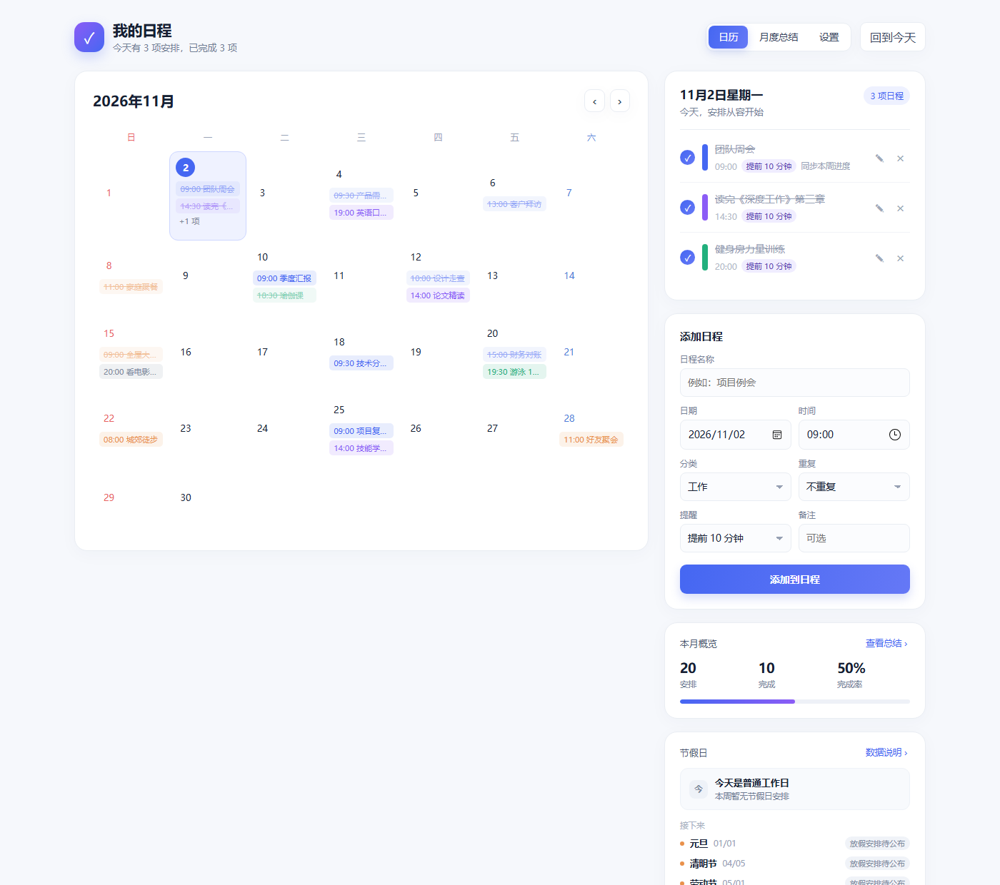
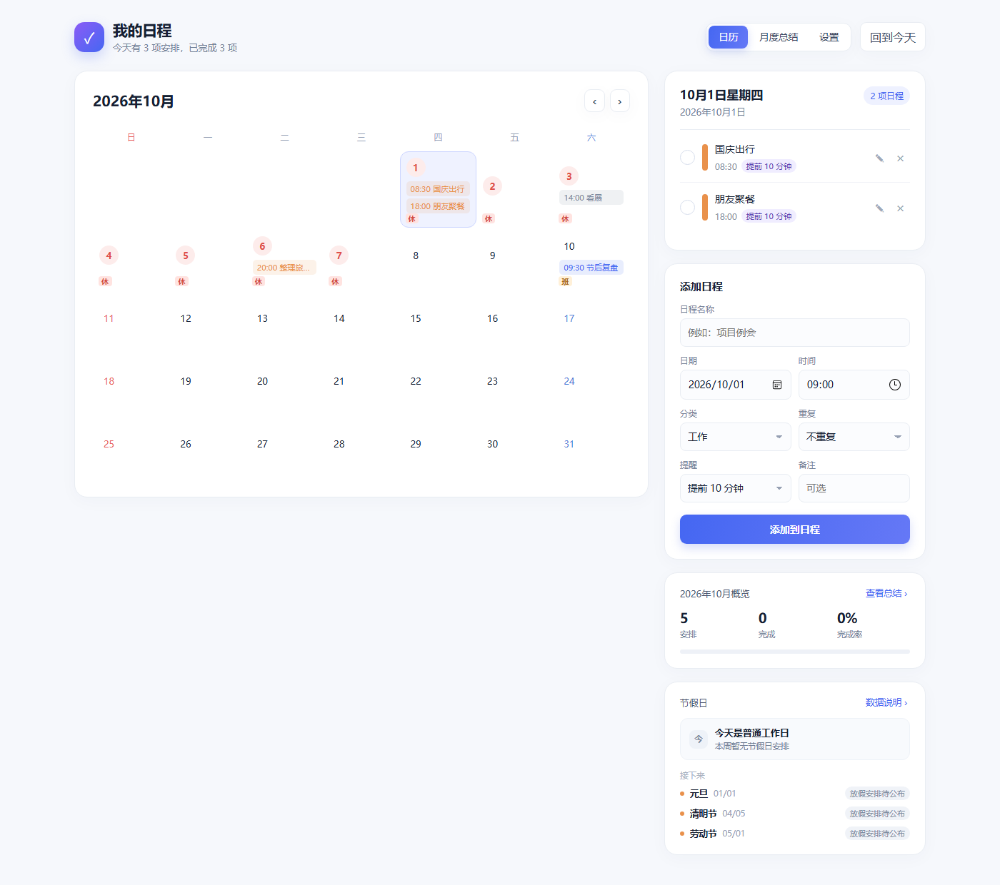
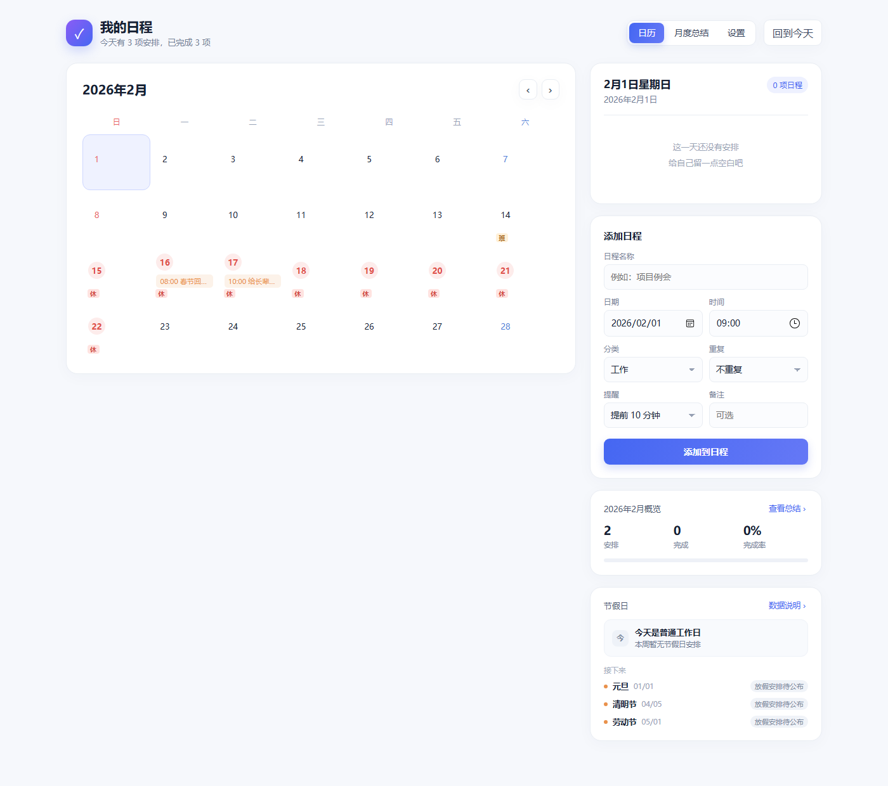
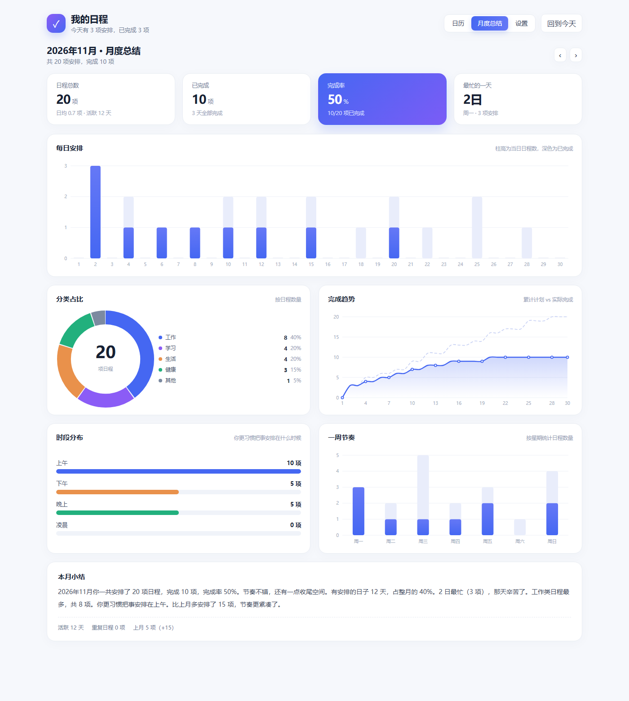
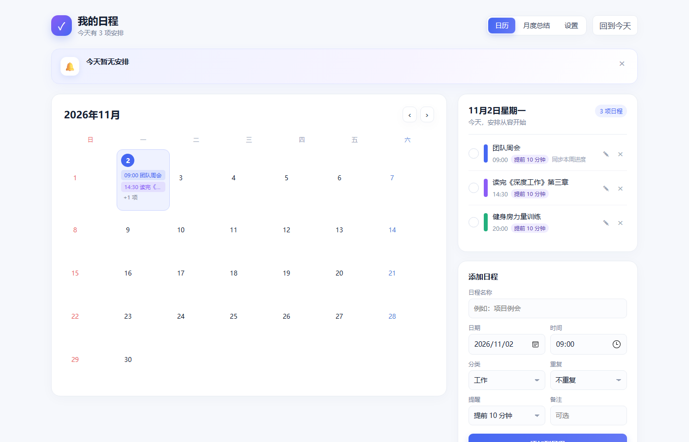
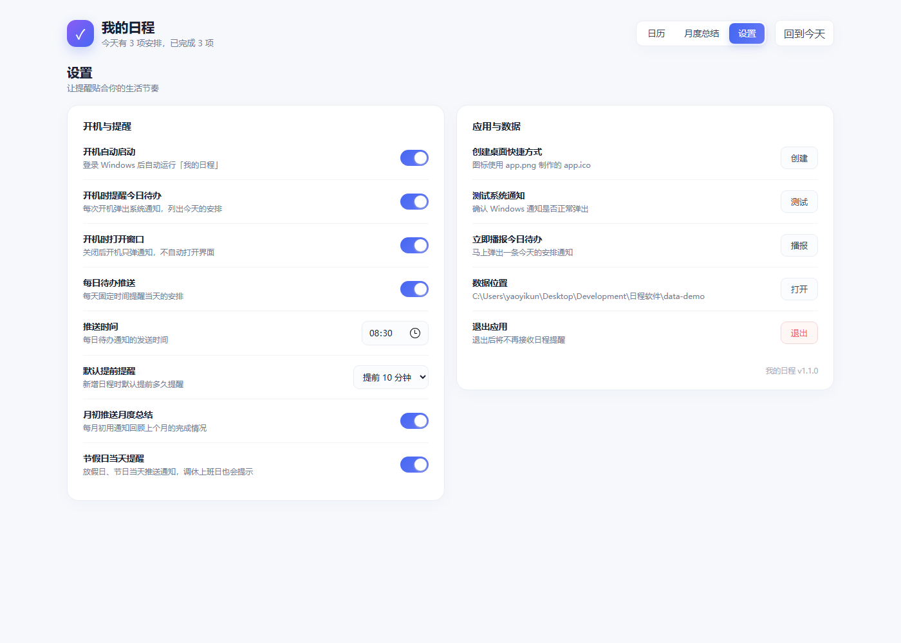
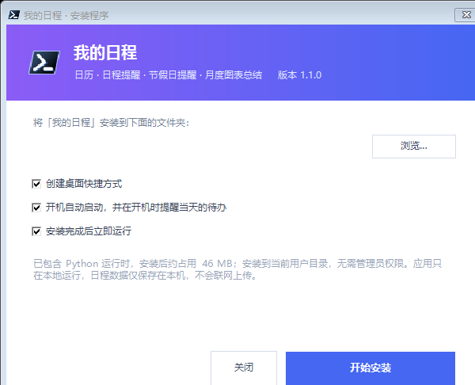

<div align="center">

# 我的日程

**一款完全离线运行的 Windows 桌面日程提醒工具**
日历 · 日程提醒 · 节假日与调休 · 月度图表总结


</div>

---

## 界面预览

| 日历 + 今日行程 | 节假日与调休标注 |
| :---: | :---: |
|  |  |

| 春节连休 | 月度图表总结 |
| :---: | :---: |
|  |  |

| 开机 / 到点提醒横幅 | 设置 |
| :---: | :---: |
|  |  |

<details>
<summary>安装向导（点击展开）</summary>



</details>

> 截图中的日程为演示数据。

---

## ✨ 功能特性

- **日历界面**：月视图 + 选中日期的行程列表，支持分类色标、完成打卡、编辑 / 删除
- **日程提醒**：支持准时、提前 5/10/15/30 分钟、1/2 小时、1 天提醒；系统通知 + 应用内提示双通道
- **节假日与调休**：内置中国法定节假日，放假目标「休」、调休上班日标「班」，节假日当天自动提醒
- **周末配色**：周日红 / 周六蓝 / 工作日深灰，符合日历习惯
- **开机播报**：开机自动启动并推送「今天有 N 项待办」
- **月度总结**：5 张手写 SVG 图表（每日安排、分类占比、完成趋势、时段分布、一周节奏）+ 自动生成的文字小结
- **重复日程**：每天 / 每周 / 每月，月末自动对齐
- **完全离线**：不联网、不上传数据，日程只保存在本机 `data/schedule.json`
- **零第三方依赖**：仅用 Python 标准库 + 原生 HTML/CSS/JS

---

## 📥 下载与安装

前往 [**Releases**](../../releases) 页面下载最新版本：

| 文件 | 说明 |
| --- | --- |
| `我的日程_安装包_vX.Y.exe` | 安装版，**内置 Python 运行时**，目标电脑无需装 Python |
| `我的日程_便携版_vX.Y.zip` | 绿色版，解压后双击 `启动日程软件.vbs` 即可 |

安装程序会（默认安装到 `%LOCALAPPDATA%\Programs\我的日程`，**无需管理员权限**）：

1. 解压程序与内置 Python 运行时
2. 创建桌面 / 开始菜单快捷方式
3. 按需创建开机启动项
4. 注册通知身份，让系统通知显示为「我的日程」
5. 写入「设置 → 应用」卸载登记

> 安装包未做代码签名，首次运行可能出现 SmartScreen 提示「Windows 已保护你的电脑」，
> 点「更多信息 → 仍要运行」即可。

**系统要求**：Windows 10 / 11（64 位），.NET Framework 4.8（系统自带）。

---

## 🚀 从源码运行

需要本机已安装 Python 3.8+（安装时勾选 *Add Python to PATH*）：

```bash
git clone https://github.com/<你的用户名>/<仓库名>.git
cd <仓库名>
```

然后双击 **`启动日程软件.vbs`**（无黑窗启动），或运行：

```bash
python backend/app.py
```

排错时可用 `调试启动.bat`，日志写在 `data/app.log`。

> 界面由系统自带的 Microsoft Edge 以「应用模式」打开（`--app=` 独立窗口，无地址栏），
> 找不到 Edge 时依次尝试 Chrome，最后退回默认浏览器。

---

## 🏖 节假日数据

数据整理自国务院办公厅历年《关于部分节假日安排的通知》，存放在
[`backend/holidays.json`](backend/holidays.json)：

```json
{
  "source": "国务院办公厅历年《关于部分节假日安排的通知》",
  "provisionalYears": [2026],
  "days": {
    "2026-10-01": { "type": "rest", "name": "国庆节", "festival": true },
    "2026-10-10": { "type": "work", "name": "国庆节调休" }
  }
}
```

- `type`：`rest`（放假）/ `work`（调休上班）
- `festival: true`：表示节日当天，用于当天提醒文案
- `provisionalYears`：标注哪些年份的安排尚待官方确认（界面会用灰色「参考」提示）

**更新方式**（无需重新打包）：把同名文件放到数据目录 `data/holidays.json` 即可覆盖 / 补充，
重启应用生效。

> ⚠️ 内置数据覆盖 2024–2026 年，其中 **2026 年为参考安排，请以官方通知为准**；
> 2027 年及以后尚未公布，界面会显示「放假安排待公布」。
> 数据未覆盖的年份，元旦 / 清明 / 劳动节 / 国庆会按法定日期自动兜底提醒。

---

## 🗂 项目结构

```
.
├─ backend/                Python 后端（本地 HTTP 服务）
│  ├─ app.py               服务、API、提醒调度、窗口启动
│  ├─ store.py             数据存储、重复日程展开
│  ├─ stats.py             月度统计与文字总结
│  ├─ holidays.py          节假日解析、连休区间、提醒文案
│  ├─ holidays.json        法定节假日与调休数据
│  ├─ notify.py            系统通知、快捷方式、开机自启
│  ├─ popup.py             桌面提醒小窗（通知兜底）
│  └─ *.ps1                PowerShell 桥（Toast / 快捷方式 / AUMID 注册）
├─ web/                    前端（原生 HTML/CSS/JS，无构建步骤）
│  ├─ index.html
│  ├─ css/style.css
│  └─ js/{app.js, charts.js}
├─ installer/              安装包源码（C# + 构建脚本）
│  ├─ setup.cs             安装程序
│  ├─ uninstall.cs         卸载程序
│  └─ build.ps1            一键打包
├─ assets/                 图标资源
├─ docs/screenshots/       README 截图
├─ tools/                  辅助脚本（图标生成、界面自检）
├─ index_re.html           原始界面设计稿（设计参照）
├─ 启动日程软件.vbs         静默启动器
└─ 调试启动.bat            调试启动
```

---

## 🔧 自行打包

```powershell
pwsh -File installer/build.ps1 -Version 1.1.0
```

构建脚本会：收集应用文件 → 裁剪 Python 运行时（约 516 MB 安装目录 → 43 MB）→ 生成便携版
→ 编译 `uninstall.exe` → 打包 `payload.zip` → 编译内嵌载荷的 `setup.exe` → 输出到 `dist/`。

依赖：Windows 自带的 `csc`（.NET Framework 4.x）+ 本机 Python 3 安装目录（可自动探测，
也可用 `-PythonRoot` 指定）。

**命令行参数**

| 用法 | 说明 |
| --- | --- |
| `我的日程_安装包_vX.Y.exe` | 图形安装向导 |
| `...exe /S --dir "D:\Apps\我的日程"` | 静默安装到指定目录 |
| `uninstall.exe` | 卸载（询问是否删除数据） |
| `uninstall.exe /S` | 静默卸载，保留 `data` |
| `uninstall.exe /S /purge` | 静默卸载并删除数据 |

---

## ❓ 常见问题

<details>
<summary><b>没有弹出系统通知？</b></summary>

1. 设置 → 测试系统通知；
2. 检查 Windows「设置 → 系统 → 通知」是否允许；
3. 首次运行会自动注册通知身份（注册表 + 开始菜单快捷方式）。若注册失败，提醒会改用
   桌面提醒小窗；删除 `data/notify-appid.txt` 后重启应用可重新注册。
</details>

<details>
<summary><b>界面没有打开？</b></summary>

程序会依次尝试 Edge → Chrome 的应用模式，都没有时用默认浏览器。
端口默认 `127.0.0.1:47823`（被占用时自动顺延），重复启动只会唤醒已有窗口。
</details>

<details>
<summary><b>数据存在哪里？如何迁移？</b></summary>

全部数据在 `data/schedule.json`（安装版为 `<安装目录>\data\schedule.json`）。
整个文件夹复制过去即可迁移。
</details>

<details>
<summary><b>可以加到开机启动吗？</b></summary>

可以。设置里打开「开机自动启动」即可（写入启动文件夹快捷方式，带 `--boot` 参数）。
</details>

---

## 🧩 技术说明

- 后端：Python 标准库 `http.server`，单进程多线程，调度器每 20 秒检查一次提醒
- 前端：原生 HTML/CSS/JS，图表为手写 SVG，无任何 npm 依赖与构建步骤
- 窗口：`msedge --app=http://127.0.0.1:47823/` 独立应用窗口（冷启动约 1 秒）
- 通知：PowerShell 调用 WinRT `ToastNotificationManager`，注册表 + 快捷方式注册 AUMID
- 单实例：Windows 下关闭 `SO_REUSEADDR`，保证端口占用可被检测

---

## 📄 许可证

[MIT](LICENSE)

## 免责声明

本项目为个人自用工具，与任何官方机构无关。节假日数据整理自公开的国务院办公厅放假安排通知，
仅供参考，请以官方发布为准。
